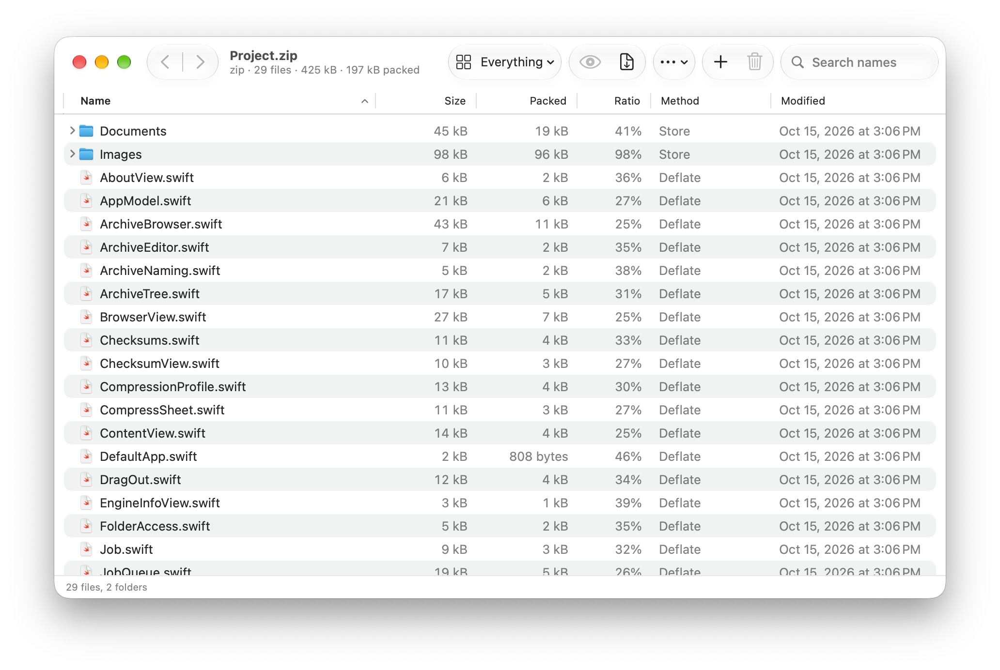

<div align="center">


# 7-Mac

**A native Mac app for 7-Zip.**
Open about 60 archive formats, create 7z and zip archives, and edit archives in place,
using the real 7-Zip engine built into the app.


<br>



</div>

---

## Why 7-Mac

Most 7-Zip front ends on the Mac run the `7zz` command-line tool and read its text output.
7-Mac builds the 7-Zip library from upstream source and calls it directly. This makes
three things possible:

- **Passwords stay out of the command line.** Each password goes from the app to the
  engine through a callback. It is never written to disk and never shows up in `ps`.
- **Progress is measured in bytes.** You get exact byte counts, throughput and ETA,
  not just a percentage.
- **Archive details come with their real types.** Sizes, dates, CRCs and POSIX
  attributes are read as values from the engine, not parsed from text.

You don't need Homebrew, a separate binary or a terminal.

## Features

**Open and extract**
- Reads about 60 formats: 7z, zip, rar/rar5, tar, gz, bz2, xz, zstd, cab, iso, dmg, wim,
  vhd/vmdk/qcow2, deb, rpm, pkg/xip and more
- Browse the archive as a tree that shows size, compression ratio, method, CRC and attributes, with sorting, search and filters
- Opens nested archives such as `.tar.gz` as a single tree
- Extracts only the items you select, either by dragging them to the Finder or by dropping the archive to extract it next to itself
- Previews files inside the archive with Quick Look (press space)

**Create and edit**
- Creates 7z, zip, tar, wim, gzip, bzip2 and xz archives
- Saves compression profiles for format, level, dictionary, method, solid block and threads, with a memory estimate
- Splits archives into multiple volumes and encrypts 7z headers
- Adds, deletes and renames items inside an existing archive, with undo/redo (⌘Z / ⇧⌘Z)

**Fits into macOS**
- Adds a 7-Mac submenu to the Finder context menu, plus a Services / Quick Action
- Shows Quick Look previews and thumbnails for archives in the Finder
- Can save passwords to the Keychain if you choose
- Includes a hash panel (SHA-256/512/3, MD5, BLAKE2sp, CRC32/64, xxh64) with checksum comparison, and a test that checks archive integrity
- Runs fully sandboxed, supports dark mode and accessibility, and is localized in
  English, Italian, German, French, Spanish, Dutch, Polish and Portuguese

## Install

Signed and notarized builds will be published on the
[Releases](https://github.com/Michediana/7-Mac/releases) page. Until then, build the app
from source as shown below.

To show the Finder menu, enable it once in **System Settings → General → Login Items &
Extensions → Finder**. Go to 7-Mac **Settings → Finder** to see whether it's enabled.

## Build from source

You need Xcode 26 or later. The 7-Zip source is vendored as a pinned release tarball
in `Vendor/7zip/`, and its checksum is verified when you build.

```sh
git clone https://github.com/Michediana/7-Mac.git
cd 7-Mac
open 7-Mac.xcodeproj        # build and run the "7-Mac" scheme
```

To check that the engine the app carries actually works, run the smoke test:

```sh
Scripts/smoke-test.sh Release
```

The first build compiles the engine for arm64 and x86_64 (about 15 seconds). Later
builds skip that step unless the source, architectures or deployment target change.

## Releasing

Releases update themselves through [Sparkle](https://sparkle-project.org). Each GitHub
release carries the notarized `7-Mac-<version>.zip` and an `appcast.xml`. The app reads
the appcast of the latest release.

Push a tag and the [Release workflow](.github/workflows/release.yml) does the rest:

```sh
git tag v1.1 && git push origin v1.1
```

To build the same release locally, run `Scripts/release.sh 1.1` (add `--publish` to
create the GitHub release too). The build number is the commit count on `HEAD`. Builds
from source carry no Sparkle key, so they never offer updates.

## How it's built

```
7-Mac.app
├─ Contents/MacOS/7-Mac              Swift / SwiftUI app
├─ Contents/PlugIns/                 Finder menu, Quick Look preview, thumbnails
└─ Contents/Frameworks/
   └─ SevenZipKit.framework          7-Zip engine + Obj-C++ shim (LGPL)
```

7-Zip's API is COM-style: abstract C++ vtables that keep their own reference counts.
A thin Objective-C++ shim implements the engine's callbacks and exposes them to Swift as
closures and `AsyncStream`s. [ROADMAP.md](ROADMAP.md) (in Italian) covers the full design,
the milestones and what was verified along the way.

## License

The app's own code is released under the [MIT License](LICENSE).

The 7-Zip engine is © Igor Pavlov and licensed under the **GNU LGPL**, with the
**unRAR restriction**: the unRAR code may not be used to recreate the RAR compression
algorithm. All of the engine's code is linked dynamically through `SevenZipKit.framework`,
so you can replace it with your own build. The full license texts are in the app under
**Help → Licenses**.

7-Mac is an independent project. It is not affiliated with or endorsed by the 7-Zip
project.
